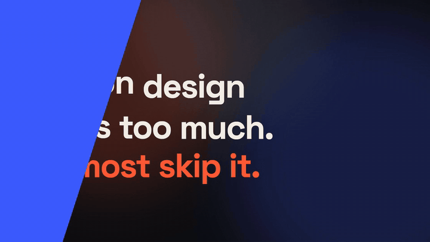

# Kinetipack Studio

**Your brand in motion.** Describe your brand in one small JSON file (colours,
fonts, a feel), and get a matching set of motion graphics: logo intro,
kinetic titles, lower thirds, transitions and a YouTube end screen. Every
piece renders in **16:9, 9:16, 4:5 and 1:1**, so the same look works on
YouTube, Shorts, Reels, TikTok and LinkedIn.

It's free and open source (MIT). Use it for your channel, your podcast, your
startup, or your clients' work.



## Quick start

You need [Node.js](https://nodejs.org) 18 or newer.

```bash
git clone https://github.com/kw3ku/kinetipack-studio.git
cd kinetipack-studio
npm install
npm run studio        # live preview at http://localhost:3000
```

Make your own brand:

```bash
cp -r brands/example-sharp brands/my-channel
# edit brands/my-channel/brand.json (see brands/README.md for every field)
npm run pack -- brands/my-channel --quick   # two showreels, about a minute
npm run pack -- brands/my-channel           # the full pack + a zip
```

The full pack lands in `brands/my-channel/out/`:

```
out/
├── preview/showreel-<format>.mp4
└── <format>/                      16x9, 9x16, 4x5, 1x1
    ├── intro.mp4  title.mp4  lower-third.mp4  end-screen.mp4
    └── overlays/                  transparent ProRes 4444, to lay over your own footage
        ├── title.mov  lower-third.mov  transition.mov
```

## How it works

Everything is built with [Remotion](https://www.remotion.dev): each animation
is a React component and a function of the frame number, so nothing is a
one-off timeline. A brand's **feel** (`sharp`, `calm` or `bouncy`) sets the
easing curves, timings, wipe angle and sound set. Its colours and fonts flow
into every component through `useBrand()`, and `useLayout()` adapts sizes to
the format.

| Path | Holds |
|---|---|
| `brands/` | One folder per brand, each with a `brand.json` |
| `src/brands/spec.ts` | `BrandSpec` (the JSON shape) and `toBrand()`, which turns feel/corners into easing, durations, radius, wipe angle |
| `src/brands/index.tsx` | `BrandProvider` (loads Google Fonts by name) and `useBrand()` |
| `src/primitives/` | Brand-agnostic, format-aware building blocks |
| `src/compositions/` | `Pack.tsx` (one component per deliverable), `Showreel.tsx`, and `Story.tsx`: a short problem → solution video for social posts, ready to copy for your own story (`npm run story`) |
| `scripts/make-pack.mjs` | Renders a brand into MP4s, transparent MOVs and a zip |
| `scripts/make-sounds.mjs` | Synthesises the sound effects from code |

### Primitives

| Component | What it does |
|---|---|
| `LogoSting` | Accent block sweeps away, logo or wordmark rises, dot pops |
| `KineticTitle` | Words rise from masks with a stagger; last line in the accent colour |
| `LowerThird` | Accent rule and name card unroll, hold, retract |
| `Wipes` | Transitions: `bands`, `iris`, `blinds` |
| `EndScreen` | Heading, two slots for YouTube end-screen videos, a call to action |
| `Plate` | Drifting colour fields, a stand-in for real footage |
| `Sfx` | Plays a cue from the brand's sound set |

Want a new animation? Write a component in `src/primitives/` that reads
`useBrand()` and `useLayout()`, and it works with every brand and format.

### Sound

Each feel has its own set of four cues (whoosh, hit, pop, tick). They're
generated by `scripts/make-sounds.mjs` from pure maths, with no samples, so
they're covered by the same MIT licence as the code. Set `"sound": "off"` in
`brand.json` for silent renders.

## Licences, please read

- **This project's code and sounds:** [MIT](LICENSE). Use, change and sell
  what you make with it.
- **Remotion** has its own licence. It's free for individuals, non-profits
  and companies of up to 3 people; larger companies need a
  [Remotion company licence](https://www.remotion.dev/license). Check it
  before using this commercially.
- **Fonts** come from Google Fonts, which are mostly under the SIL Open Font
  Licence.
- **Your brand** stays yours. The example brands (Northline, Harbour, Pop
  Club) are made up and free to reuse. The MIT licence doesn't cover the
  name "Kinetipack" or any logos.

## Contributing

Ideas, bug reports and new primitives are welcome. See
[CONTRIBUTING.md](CONTRIBUTING.md).

Made in Accra by [Kwaku Dompreh](https://github.com/kw3ku).
